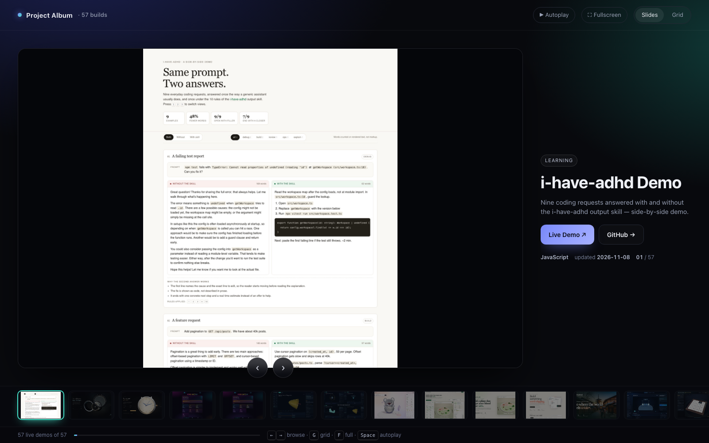

# Project Album

A slideshow of every build in `~/Projects`: one screenshot each, with the GitHub repo and
the live demo link. 57 projects, generated from the repos themselves — nothing is typed by hand.



## Open it

```bash
open ~/Projects/project-album/index.html
```

Single-file HTML plus the `img/` folder; works offline, no server needed.

| Key | Action |
| --- | --- |
| `←` `→` | previous / next project |
| `G` | toggle slides ↔ grid |
| `F` | fullscreen |
| `Space` | autoplay (5.2s per slide) |

Grid mode also filters by tag (3D World, Game, Learning, Studio, Anatomy, Health) and by free text.

## Rebuild

```bash
node build.mjs
```

The script:

1. finds every git repo with a `github.com` origin under `~/Projects`, plus the finished builds
   listed in `EXTRA_REPOS` that live outside it (currently `~/bangkok-miniature`), and uses the
   repo slug from the remote (not the folder name) for every link;
2. picks the best local screenshot per repo (prefers `screenshot.png` → `hero` → `preview`, ranks
   landscape images above portrait/logo/social cards, ignores images narrower than 420px);
3. resizes it to 1500px wide JPEG (`quality 80`) into `img/<repo>.jpg`;
4. resolves the live demo — `github.io/<repo>/` first, then the repo's declared homepage — and
   records whether it returns a non-404;
5. falls back to a headless Chrome capture of the live page only when no local image exists;
6. writes `data.json` and injects it into `template.html` → `index.html`.

Edit `template.html` for layout/behaviour, `OVERRIDES` for display names, `IMG_OVERRIDE` for a
repo whose automatic pick is wrong, and `TAGS` for the category regexes.

`build.mjs` uses the GitHub API once per repo and caches responses in `.meta-cache.json`
(unauthenticated quota is 60/hour, so repeated runs must not re-hit it). Descriptions fall back to
the first prose line of the local README, dates to the last git commit, and language to the most
common tracked file extension — so a rebuild works fully offline.

## Notes

- `learncpp` is deliberately excluded: its GitHub repo is not public (404), so the card would have
  a dead link. Add it back by removing it from the `SKIP` set in `build.mjs`.
- `bangkok-miniature` lives at `~/bangkok-miniature`, not in `~/Projects`; it is listed in
  `EXTRA_REPOS` so the finished build still appears.
- `city-miniature`'s live page draws its WebGL canvas after a headless screenshot fires, so its
  image is pinned to the skill's own `docs/preview.png`.
- `aurelis-watch/` checks out as `somphol/aurelis-calibre-07`; the album keys cards by remote slug,
  so the folder name is irrelevant.
- `opencode-skills` links to a JSON catalog, not a web page; its card uses the contact sheet in
  `assets/`, regenerated from `assets/opencode-skills-sheet.html`.
- `preview.png` is the album's own hero shot.
